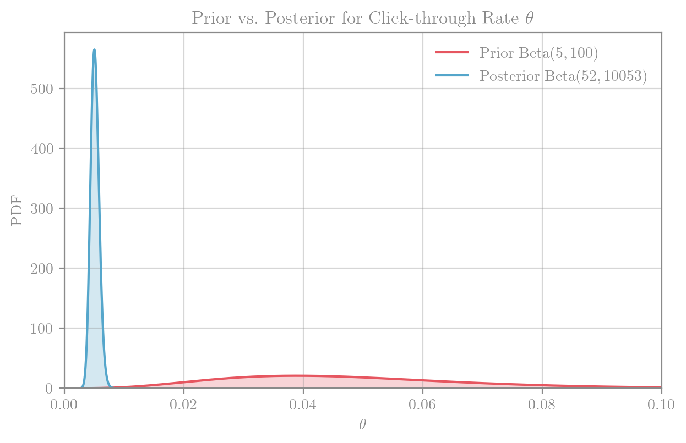

---
# This page also displays R examples, so declare the Python engine explicitly.
jupyter: mas2901
---

# Bayesian Inference {#sec-bayes-inference}

```{python}
#| echo: false

import matplotlib.pyplot as plt

def set_plot_theme(mode="light"):
    """Switch matplotlib colours between light and dark themes."""
    
    if mode == "light":
        plot_bg, plot_fg = "#f8f8f8", "#333333"
    elif mode == "dark":
        plot_bg, plot_fg = "#151515", "#EAEAEA"
    else:
        raise ValueError("mode must be 'light' or 'dark'")

    # Backgrounds
    plt.rcParams["figure.facecolor"] = plot_bg
    plt.rcParams["axes.facecolor"]   = plot_bg
    plt.rcParams["savefig.facecolor"] = plot_bg

    # Foregrounds
    plt.rcParams["text.color"]       = plot_fg
    plt.rcParams["axes.labelcolor"]  = plot_fg
    plt.rcParams["axes.edgecolor"]   = plot_fg
    plt.rcParams["xtick.color"]      = plot_fg
    plt.rcParams["ytick.color"]      = plot_fg
    plt.rcParams["legend.edgecolor"] = plot_fg
    plt.rcParams["legend.labelcolor"] = plot_fg
    plt.rcParams["grid.color"]       = plot_fg

```

::: {.content-visible unless-format="pdf"}

:::

::: {.callout-note .learning-objectives .reader-only title="Learning objectives" appearance="simple"}

By the end of this chapter, you should be able to:

1. identify the prior, likelihood, evidence, and posterior in Bayes' theorem;
2. derive conjugate posteriors up to proportionality and interpret prior strength;
3. compare the MLE, posterior mean, posterior median, and MAP estimate;
4. explain why frequentist and Bayesian Normal approximations can look similar while describing different sources of uncertainty.

The **core route** is prior $\rightarrow$ likelihood $\rightarrow$ posterior $\rightarrow$ interpretation. Code and longer algebra are supporting material; first focus on what each distribution represents and how the update changes uncertainty.
:::


## Introduction to the Bayesian Approach {#sec-intro-bayes-approach}

So far we have taken a **frequentist perspective**: parameters such as $\theta$ are fixed but unknown, and all randomness comes from the sample.

Bayesian inference takes a different view:

* **Frequentist**: the parameter $\theta$ is **fixed but unknown**.
* **Bayesian**: the parameter $\theta$ is treated as a **random variable**.

The word *random* here does **not** mean that the parameter is physically fluctuating. Instead, it represents our **uncertainty** about its true value.

### Probability as Uncertainty

In the Bayesian framework, probability is interpreted as a way of **quantifying uncertainty** about unknown quantities.

Rather than saying “*the parameter is a fixed number we don’t know*”, we describe how plausible different values are using a probability distribution.

::: {#exm-bayes-umbrella}
#### Umbrella Decisions

Imagine the weather forecast says there is a $70\%$ chance of rain tomorrow.

* For a particular tomorrow, rain either occurs or it does not.

* The number $70\%$ can express our uncertainty given current information; across well-calibrated forecasts issued at $70\%$, rain should also occur about $70\%$ of the time.

::: {.content-visible unless-format="pdf"}

```{=html}
<details>
  <summary><strong> Show Plot </strong></summary>
```



```{=html}
</details>
```

:::

:::

::: {#exm-bayes-exam-marks}
#### Exam Marks

Suppose $\theta$ is the average exam mark of a module. From past years, we believe:

* It’s usually around $60$ marks,

* but could reasonably be anywhere between $50$ and $70$.

We could represent this belief as a Normal prior distribution centred at $60$ with standard deviation $10$.

::: {.content-visible unless-format="pdf"}

```{=html}
<details>
  <summary><strong> Show Plot </strong></summary>
```



```{=html}
</details>
```

:::

:::

::: {#exm-bayes-disease}
#### Disease Prevalence
Let $\theta$ be the proportion of people with a rare condition.

Before collecting data, experts might believe $\theta$ is “probably around $2\%$, and very unlikely to exceed $10\%$”.

We could express this with a <span class="xref-no-num">[Beta distribution @sec-beta]</span> prior.

::: {.content-visible unless-format="pdf"}

```{=html}
<details>
  <summary><strong> Show Plot </strong></summary>
```



```{=html}
</details>
```

:::

:::

This provides a **language of degrees of belief**: probability distributions describe how plausible different values of $\theta$ are, given what we know.

### The Bayesian Inference Procedure {#sec-bayes-inference-procedure}

The Bayesian approach to inference has three ingredients:

1. **Prior** — a probability distribution that captures what we believe about $\theta$ *before* seeing the data.
2. **Likelihood** — the sampling model evaluated at the observed data, viewed as a function of $\theta$.
3. **Posterior** — the updated distribution for $\theta$ that combines prior information with the evidence from the data.

The update is performed using **Bayes’ theorem** (introduced in the next section). Intuitively:

$$
\text{Posterior} \;\; \propto \;\; \text{Likelihood} \times \text{Prior}.
$$

This equation expresses the central idea: *our beliefs about $\theta$ are revised in light of the observed data*.

## Bayes' Theorem for Densities 

Bayesian inference is named after <span class="xref-no-num">[Bayes’ Theorem @thm-bayes]</span>, a general identity in probability theory. For two events $A$ and $B$, the conditional probability is given by
$$
\mathrm{Pr}(A \mid B) = \frac{\mathrm{Pr}(B \mid A)\,\mathrm{Pr}(A)}{\mathrm{Pr}(B)}.
$$
This rule is sometimes described as **reversing conditioning**: it lets us swap the order, turning “$B$ given $A$” into “$A$ given $B$,” with a correction for their overall probabilities.

To apply this idea in Bayesian inference, we extend it from events to random variables and their densities. Using <span class="xref-no-num">[conditional densities @def-conditional-pdf]</span>,
$$
f_{X \mid Y}(x \mid y) = \frac{f_{XY}(x,y)}{f_Y(y)},
$$

we arrive at Bayes’ theorem for densities.

::: {.thm #thm-bayes-density}
### Bayes’ Theorem for Densities.
For random variables $X$ and $Y$ with joint density (or PMF) $f(x,y)$, at values where the relevant marginal densities (or PMFs) are positive:

$$
f(x \mid y) = \frac{f(y \mid x)\,f(x)}{f(y)}.
$$

:::

::: {.prf #prf-bayes-density}
By the definition of conditional density:

$$
f(x \mid y) = \frac{f(x,y)}{f(y)}, 
\qquad
f(y \mid x) = \frac{f(x,y)}{f(x)}.
$$

Rearranging the second expression gives $f(x,y) = f(y \mid x) f(x)$. Substituting this into the first gives

$$
f(x \mid y) = \frac{f(y \mid x) f(x)}{f(y)}.
$$
:::


## Bayes’ Theorem in Statistics

Once we have specified a parameter $\theta$, the model tells us the **distribution of the data**:
$$
f(\underline{x} \mid \theta).
$$

This is the <span class="xref-no-num">[likelihood @def-likelihood]</span> from Chapter 5.

Our Bayesian goal is the reverse: to describe the **distribution of the parameter given the data**:
$$
\pi(\theta \mid \underline{x}).
$$

This is exactly the “reversing conditioning” step that <span class="xref-no-num">[Bayes’ theorem @thm-bayes]</span> makes possible. It takes the likelihood $f(\underline{x}\mid \theta)$ and the prior $\pi(\theta)$ and turns them into the posterior $\pi(\theta \mid \underline{x})$:
$$
\text{Known: } f(\underline{x}\mid \theta)
\quad\;\; \xRightarrow[\text{Bayes’ theorem}]{} \quad\;\;
\text{Wanted: } \pi(\theta \mid \underline{x})
$$

::: {.remark}
### Likelihood vs. Likelihood Function
Here we use **likelihood** to mean the joint density/PMF $f(\underline{x}\mid\theta)$ itself.  

When viewed as a function of $\theta$ (with the data fixed), this is the <span class="xref-no-num">[likelihood function @def-likelihood]</span>. In this course, we will not stress this distinction further.
:::


::: {#imp-notation-bayes .callout-important collapse="true" appearance="simple"}

### Notation in Bayesian Statistics

Both frequentist and Bayesian inference involve probability distributions for the **data**.

* In the **frequentist setting** we write

  $$
  X_i \sim \mathrm{Distribution}(\theta),
  $$

  where $\theta$ is a fixed but unknown parameter.

* In the **Bayesian setting** we write

  $$
  X_i \mid \theta \sim \mathrm{Distribution}(\theta),
  $$

  where the conditioning bar $\mid \theta$ emphasises that $\theta$ itself is random, and we are describing the distribution of the data **given** a particular value of $\theta$.

In both cases, $f(x_i \mid \theta)$ denotes the PDF/PMF of the data conditional on $\theta$.

---

**The Bayesian addition:** we also introduce probability distributions *over the parameter $\theta$ itself*.
To emphasise the difference in notation:

* **Prior distribution** (before data): $\pi(\theta)$
* **Posterior distribution** (after data): $\pi(\theta \mid \underline{x})$

In Bayesian inference there are therefore two distinct kinds of distributions, which our notation keeps separate:

* **Data distributions:** $f(x \mid \theta)$ describe how the data would look *if we knew $\theta$*.
* **Parameter distributions:** $\pi(\theta)$ and $\pi(\theta \mid \underline{x})$ describe our *uncertainty about $\theta$*.

:::

### From Bayes’ theorem to the Posterior

Applying <span class="xref-no-num">[Bayes' theorem @thm-bayes-density]</span> to the parameter $\theta$ and observed sample $\underline{x}=(x_1,\ldots,x_n)$ gives
$$
\pi(\theta\mid\underline{x})
=\frac{f(\underline{x}\mid\theta)\,\pi(\theta)}{f(\underline{x})}.
$$

::: {.definition #def-prior}
### Prior Distribution

The **prior distribution** represents our uncertainty about $\theta$ before observing the data. We denote its density (or PMF) by $\pi(\theta)$.
:::

Here $f(\underline{x}\mid\theta)$ is the <span class="xref-no-num">[likelihood function @def-likelihood]</span> from Chapter 5.

::: {.definition #def-posterior}
### Posterior Distribution

The **posterior distribution** represents our updated uncertainty about $\theta$ after observing $\underline{x}$.

The denominator $f(\underline{x})$ is called the **evidence**:
$$
f(\underline{x})
=\int_{\Theta}f(\underline{x}\mid\theta)\,\pi(\theta)\,\mathrm{d}\theta.
$$
It makes the posterior density integrate to one.
:::

#### Why don't we need to evaluate $f(\underline{x})$ here? {#sec-bayes-normalisation .unnumbered}

The posterior $\pi(\theta\mid\underline{x})$ is a function of $\theta$, with the observed data $\underline{x}$ fixed. Since the denominator $f(\underline{x})$ does not depend on $\theta$, we can treat it as a normalising constant:

::: {#imp-bayes-proportionality .callout-important appearance="simple"}
#### Posterior Density Up to a Constant of Proportionality

$$
\boxed{\pi(\theta\mid\underline{x})\propto
f(\underline{x}\mid\theta)\,\pi(\theta).}
$$
The symbol $\propto$ means “is proportional to”: there is a missing **multiplicative constant**. Here, it means
$$
\pi(\theta\mid\underline{x})
=C(\underline{x})\,f(\underline{x}\mid\theta)\,\pi(\theta),
\qquad C(\underline{x})=\frac{1}{f(\underline{x})}.
$$
The constant $C(\underline{x})$ may depend on the observed data, but not on $\theta$. It makes the posterior density integrate to one.

We can leave out factors that do not depend on $\theta$, keeping the range of possible values of $\theta$. We then compare the result with a known density to identify the posterior distribution.
:::

In the **conjugate examples below**, the posterior belongs to a familiar distribution family. Its density formula supplies the normalising constant, so we do not need to calculate $f(\underline{x})$ separately.

In other applications, such as comparing models, we may need to evaluate the evidence integral analytically or numerically. These applications are outside this course and are not examinable.

[]{#sec-posteriors-in-practice}

We first apply this method to the coin example, then use the same steps for two more general updates.

:::: {.example #exm-biased-coin}
## Biased Coin

Let $\theta=\Pr(\text{Head})$ for a possibly biased coin.

- **Prior:** $\theta\sim\mathrm{Uniform}(0,1)\equiv\mathrm{Beta}(1,1)$.
- **Data:** toss the coin $n=5$ times and observe $x=1$ head.
- **Model:** $X\mid\theta\sim\mathrm{Binomial}(5,\theta)$.

Determine the posterior distribution of $\theta\mid X=1$.
Here $X$ counts heads among five conditionally independent tosses.[^binomial]

<details class="solution">
<summary><strong>Solution</strong></summary>

**1. Prior.**
$$
\pi(\theta)=1,\qquad 0<\theta<1,
$$
and it is zero elsewhere.

**2. Likelihood.**
$$
f(x=1\mid\theta)=\binom51\theta(1-\theta)^4
=5\theta(1-\theta)^4.
$$

**3. Multiply the likelihood and prior.**
$$
\pi(\theta\mid X=1)
\propto f(x=1\mid\theta)\,\pi(\theta)
=5\theta(1-\theta)^4\times1
\propto\theta(1-\theta)^4,\qquad 0<\theta<1.
$$

**4. Identify the distribution.**
The <span class="xref-no-num">[Beta density @sec-beta]</span> is proportional to
$$
\theta^{a-1}(1-\theta)^{b-1},\qquad 0<\theta<1.
$$
Comparing powers gives $a-1=1$ and $b-1=4$, so $a=2$ and $b=5$. Therefore,
$$
\boxed{\theta\mid X=1\sim\mathrm{Beta}(2,5).}
$$
From the Beta density formula,
$$
\pi(\theta\mid X=1)
=\frac{\Gamma(7)}{\Gamma(2)\Gamma(5)}
 \theta(1-\theta)^4
=30\theta(1-\theta)^4,\qquad 0<\theta<1,
$$
with zero density elsewhere. We did not need to calculate $f(x=1)$.

Both the prior $\mathrm{Beta}(1,1)$ and posterior $\mathrm{Beta}(2,5)$ are Beta distributions.

**Likelihood curve.**

```{python}
#| echo: false
#| fig-align: center
#| renderings: [light, dark]
#| fig-alt: "Binomial likelihood for one head in five tosses. The curve is zero at theta equals zero and one, and has its maximum at theta equals 0.2."

import matplotlib.pyplot as plt
import numpy as np
import math

set_plot_theme("light")

def binom_lik(theta):
    return 5 * theta * (1 - theta) ** 4


theta_grid = np.linspace(0, 1, 200)
binom_lik_vals = binom_lik(theta_grid)

plt.figure(figsize=(5,3))
plt.plot(theta_grid, binom_lik_vals)
plt.xlabel(r"$\theta$")
plt.ylabel("Likelihood")
plt.title("Binomial Likelihood (with $n=5$ and $X=1$)")
plt.tight_layout()
plt.show()  

set_plot_theme("dark")

plt.figure(figsize=(5,3))
plt.plot(theta_grid, binom_lik_vals)
plt.xlabel(r"$\theta$")
plt.ylabel("Likelihood")
plt.title("Binomial Likelihood (with $n=5$ and $X=1$)")
plt.tight_layout()
plt.show()  

```

The likelihood is largest at $\theta=0.2$, the observed proportion of heads. This is also the <span class="xref-no-num">[MLE @exm-binom-mle-single]</span>.

**Prior and posterior.**

The prior is flat on $(0,1)$. The posterior gives more weight to smaller values of $\theta$ after observing one head in five tosses.

::: {.content-visible unless-format="pdf"}

:::

**Comparing summaries.**

- **Mean:** the prior mean is $0.5$ and the posterior mean is $\operatorname{E}[\theta\mid X=1]=2/7\approx0.286$.
- **Mode:** the posterior density is highest at $\theta=0.2$.
- **Standard deviation:** it decreases from approximately $0.289$ for the prior to $0.160$ for the posterior.

The posterior mean lies between the prior mean $0.5$ and the observed proportion $0.2$.

**Calculating the evidence directly.**

We can also calculate the evidence using the <span class="xref-no-num">[law of total probability @thm-total-probability-pdfs]</span>:

\begin{align*}
f(x=1)&=5\int_0^1\theta(1-\theta)^4\,\mathrm{d}\theta\\
&=5\int_0^1(u^4-u^5)\,\mathrm{d}u
\qquad (u=1-\theta)\\
&=5\left(\frac15-\frac16\right)=\frac16.
\end{align*}

Substituting this into Bayes' theorem gives the same posterior density:
$$
\pi(\theta\mid X=1)=\frac{5\theta(1-\theta)^4}{1/6}
=30\theta(1-\theta)^4,\qquad 0<\theta<1.
$$

</details>
::::

### Conjugacy {#sec-conjugacy}

The coin example illustrates **conjugacy**: a Beta prior combined with a Binomial likelihood produced another Beta distribution. The parameters changed, while the family remained the same.

::: {#def-conjugacy}

#### Conjugate Prior

Suppose $f(\underline{x} \mid \theta)$ is the joint PDF/PMF of the observations.

A prior distribution for $\theta$ is said to be **conjugate** if, after updating with the data, the posterior distribution $\pi(\theta \mid \underline{x})$ remains in the same family as the prior $\pi(\theta)$.

:::

::: {#rem-conjugcay}

#### Why is conjugacy useful?

* Conjugacy makes Bayesian updating *algebraically simple*: posterior parameters can often be obtained by just “updating counts” or “adding observations”.
* This provides intuition for how prior information and data combine, and gives closed-form formulas that are easy to compute.

:::

To find a conjugate posterior, multiply the likelihood by the prior and compare the result with a known density.

::: {#imp-compute-posterior .callout-important collapse="true" appearance="simple"}

#### Computing Posterior Distributions

1. **Compute the Likelihood.**  
   For data generated from a model $X_i \mid \theta \sim \mathrm{Distribution}(\theta)$, the likelihood in the i.i.d. case is
   $$
   f(\underline{x} \mid \theta) = \prod_{i=1}^n f(x_i \mid \theta),
   $$
   where $f(x_i \mid \theta)$ is the PDF (or PMF) of each observation.

2. **Write Down the Prior.**  
   Given a prior $\theta \sim \mathrm{Distribution}(\phi)$, write down its density
   $$
   \pi(\theta).
   $$

3. **Form the Unnormalised Posterior.**  
   Multiply the prior and likelihood:
   $$
   \pi(\theta \mid \underline{x})
   \propto \pi(\theta)\, f(\underline{x} \mid \theta),
   $$
   and **discard any terms that do not depend on $\theta$**.

4. **Identify the Posterior Family.**  
   With a <span class="xref-no-num">[conjugate prior @def-conjugacy]</span>, the resulting expression matches the same distribution family as the prior.  

   Read off the updated parameters to obtain the posterior.

:::

:::: {.example #exm-beta-binomial-general}
### Binomial model with a general Beta prior

Suppose $X\mid\theta\sim\mathrm{Binomial}(n,\theta)$ and the prior is
$$
\theta\sim\mathrm{Beta}(a,b),\qquad a,b>0.
$$
We observe $X=x$, where $x\in\{0,1,\ldots,n\}$. Derive the posterior distribution of $\theta\mid x$.

<details class="solution">
<summary><strong>Solution</strong></summary>

**1. Prior.** On $0<\theta<1$,
$$
\pi(\theta)
=\frac{\Gamma(a+b)}{\Gamma(a)\Gamma(b)}
 \theta^{a-1}(1-\theta)^{b-1}
\propto\theta^{a-1}(1-\theta)^{b-1}.
$$

**2. Likelihood.**
$$
f(x\mid\theta)=\binom nx\theta^x(1-\theta)^{n-x}
\propto\theta^x(1-\theta)^{n-x}.
$$
The Binomial coefficient depends on the observed count and $n$, but not on $\theta$.

**3. Posterior.**
\begin{align*}
\pi(\theta\mid x)
&\propto f(x\mid\theta)\,\pi(\theta)\\
&\propto\theta^x(1-\theta)^{n-x}
          \theta^{a-1}(1-\theta)^{b-1}\\
&=\theta^{(a+x)-1}(1-\theta)^{(b+n-x)-1},
\qquad 0<\theta<1.
\end{align*}

**4. Identify the family and updated parameters.**
This has the form of a Beta density with parameters $a+x$ and $b+n-x$:
$$
\boxed{\theta\mid x\sim\mathrm{Beta}(a+x,b+n-x).}
$$
Thus the Beta family is conjugate to the Binomial likelihood. The earlier coin example is the special case $a=b=1$, $n=5$, $x=1$.

</details>
::::

:::: {.example #exm-normal-variance-invgamma}
### Variation in coffee-bag weights: an Inverse-Gamma prior for a Normal variance

A coffee roaster fills 250 g bags. Assume the weights have known mean $\mu_0=250$ g and unknown variance $\gamma>0$, measured in $\mathrm{g}^2$.

Model the bag weights as conditionally independent observations
$$
X_i\mid\gamma\overset{\mathrm{i.i.d.}}{\sim}N(\mu_0,\gamma),
\qquad i=1,\ldots,n,
$$
and place the prior
$$
\gamma\sim\mathrm{InvGamma}(a,b),\qquad a,b>0.
$$
Using the <span class="xref-no-num">[Inverse-Gamma convention on the formula sheet @sec-inv-gamma]</span>, its density is
$$
\pi(\gamma)=\frac{b^a}{\Gamma(a)}
\gamma^{-(a+1)}\exp\!\left(-\frac b\gamma\right),
\qquad\gamma>0.
$$
Let $\underline{x}=(x_1,\ldots,x_n)$ be the observed weights and write
$$
Q=\sum_{i=1}^n(x_i-\mu_0)^2.
$$

1. Derive the posterior distribution of $\gamma$.
2. State the posterior when $a=3$, $b=8$, $n=12$ and $Q=72$.

<details class="solution">
<summary><strong>Solution</strong></summary>

**1. Prior.**
$$
\pi(\gamma)\propto
\gamma^{-(a+1)}\exp\!\left(-\frac b\gamma\right),
\qquad\gamma>0.
$$

**2. Likelihood.**
Conditional independence gives
\begin{align*}
f(\underline{x}\mid\gamma)
&=\prod_{i=1}^n\frac1{\sqrt{2\pi\gamma}}
   \exp\!\left[-\frac{(x_i-\mu_0)^2}{2\gamma}\right]\\
&=(2\pi)^{-n/2}\gamma^{-n/2}
   \exp\!\left(-\frac Q{2\gamma}\right)\\
&\propto\gamma^{-n/2}
   \exp\!\left(-\frac Q{2\gamma}\right).
\end{align*}
We leave out $(2\pi)^{-n/2}$ because it does not depend on $\gamma$.

**3. Posterior.**
\begin{align*}
\pi(\gamma\mid\underline{x})
&\propto
 \gamma^{-(a+1)}\exp\!\left(-\frac b\gamma\right)
 \gamma^{-n/2}\exp\!\left(-\frac Q{2\gamma}\right)\\
&=\gamma^{-(a+n/2+1)}
 \exp\!\left[-\frac{b+Q/2}{\gamma}\right],
\qquad\gamma>0.
\end{align*}

**4. Identify the family and updated parameters.**
This has the form of an Inverse-Gamma density:
$$
\boxed{\gamma\mid\underline{x}\sim
\mathrm{InvGamma}\!\left(a+\frac n2,\ b+\frac Q2\right).}
$$
The Inverse-Gamma family is therefore conjugate for the variance of a Normal model with known mean. For the stated data,
$$
\gamma\mid\underline{x}\sim
\mathrm{InvGamma}(3+6,\ 8+36)
=\boxed{\mathrm{InvGamma}(9,44)}.
$$

Since the mean is known, we calculate $Q$ using $\mu_0=250$ g.

</details>
::::

[]{#sec-bayes-additional-examples}

::: {#exm-music-expert}
Consider an experiment to determine how good a music expert is at distinguishing between pages from Haydn and Mozart scores. Let $\theta=\mathrm{Pr}(\text{correct choice})$. Suppose that, before conducting the experiment, we have been told that the expert is very competent. In fact, it is suggested that we should have a prior distribution which has a mode around $\theta=0.95$ and for which $\mathrm{Pr}(\theta<0.8)$ is very small. We choose $\theta\sim \textrm{Beta}(77,5)$, with probability density function
$$
\pi(\theta)=128107980\,\theta^{76}(1-\theta)^4,\quad\quad 0<\theta<1.
$$
A graph of this prior density is given as follows:

::: {.panel-tabset}

### Python


```{python}
#| echo: true
#| code-fold: true
#| code-summary: "Show code"
#| fig-align: center
#| renderings: [light, dark]
#| fig-alt: "Beta(77, 5) prior density for the probability of a correct answer. Most density is close to one, with a peak near 0.95 and very little density below 0.8."
#| 
import numpy as np
import math
import matplotlib.pyplot as plt

set_plot_theme("light")

# Beta(α, β) with α=77, β=5  →  π(θ) ∝ θ^(76) (1-θ)^(4)
alpha, beta = 77, 5

# B(α,β) = Γ(α)Γ(β)/Γ(α+β)  ⇒  1/B = exp(lgamma(α+β) - lgamma(α) - lgamma(β))
# Note the lgamma function computes the logarithm of the Gamma function.
beta_const_inv = math.exp(math.lgamma(alpha + beta) - math.lgamma(alpha) - math.lgamma(beta))

def beta_pdf(theta):
    return beta_const_inv * np.power(theta, alpha - 1) * np.power(1 - theta, beta - 1)

theta_grid = np.linspace(0.0, 1.0, 500)
pdf_values = beta_pdf(theta_grid)

plt.figure(figsize=(7,4))
plt.plot(theta_grid, pdf_values)
plt.xlabel(r"$\theta$")
plt.ylabel("Density")
plt.title(rf"Beta PDF: $\alpha={alpha}$, $\beta={beta}$")
plt.tight_layout()
plt.show()

set_plot_theme("dark")

plt.figure(figsize=(7,4))
plt.plot(theta_grid, pdf_values)
plt.xlabel(r"$\theta$")
plt.ylabel("Density")
plt.title(rf"Beta PDF: $\alpha={alpha}$, $\beta={beta}$")
plt.tight_layout()
plt.show()

```

### R

```{r}
#| echo: true
#| code-fold: true
#| code-summary: "Show code"
#| fig-align: center

alpha <- 77
beta  <- 5

# Normalising constant via log-gamma (works like Python's lgamma)
beta_const_inv <- exp(lgamma(alpha + beta) - lgamma(alpha) - lgamma(beta))

beta_pdf <- function(theta) {
  beta_const_inv * theta^(alpha - 1) * (1 - theta)^(beta - 1)
}

theta_grid <- seq(0, 1, length.out = 500)
pdf_values <- beta_pdf(theta_grid)

plot(theta_grid, pdf_values, type = "l",
     xlab = expression(theta), ylab = "Density",
     main = bquote("Beta PDF: " ~ alpha == .(alpha) ~ "," ~ beta == .(beta)))
```

:::

(a) Derive the general posterior distribution assuming $\theta \sim \mathrm{Beta}(a,b)$ and $X\mid \theta \sim \mathrm{Binomial}(n, \theta)$.
(b) Compute the posterior distribution when the observed data consist of $x = 5$ correct responses out of $n = 10$ questions.


```{=html}
<details>
  <summary><strong> Solution </strong></summary>
```

(a) We have
  $$
  \pi(\theta) =  \frac{\Gamma(a+b)}{\Gamma(a)\Gamma(b)}\theta^{a-1} (1-\theta)^{b-1} \propto  \theta^{a-1} (1-\theta)^{b-1}
  $$
  and
  $$
  f(x \mid \theta) = \binom{n}{x} \theta^x(1-\theta)^{n-x} \propto \theta^x(1-\theta)^{n-x}
  $$
  Therefore
  $$
  \pi(\theta \mid x) \propto \theta^{a + x - 1} (1-\theta)^{b + n - x - 1}
  $$
  which takes the form of a $\theta \mid x \sim \mathrm{Beta}(a + x, b+n-x)$ distribution.
(b) For this example, we have the prior parameters $a = 77$ and $b=5$, for the data we have $x=5$ and $n=10$. Therefore, the posterior is
  $$
  \theta \mid x=5 \sim \mathrm{Beta}(82, 10).
  $$

**Interpretation and sensitivity.** The prior is strong: $a+b=82$ acts like roughly 82 prior observations in the posterior-mean calculation, compared with only 10 new responses. The prior mean is $77/82\approx0.939$, the data proportion is $5/10=0.5$, and the posterior mean is $82/92\approx0.891$. The posterior therefore remains close to the prior despite a clear prior–data conflict. With the much weaker $\mathrm{Beta}(1,1)$ prior, the same data would give $\mathrm{Beta}(6,6)$ with posterior mean $0.5$. Reporting this comparison makes the influence of the prior visible rather than treating the update as purely mechanical.

A graph of the posterior density is given as follows:

::: {.panel-tabset}

### Python


```{python}
#| echo: true
#| code-fold: true
#| code-summary: "Show code"
#| fig-align: center
#| renderings: [light, dark]
#| fig-alt: "Beta(82, 10) posterior density after five correct answers in ten trials. The peak is near 0.9, lower than the prior peak near 0.95, but the strong prior still favours high accuracy."
#| 
import numpy as np
import math
import matplotlib.pyplot as plt

set_plot_theme("light")

# Posterior Beta(82, 10)  →  π(θ | x) ∝ θ^(81) (1-θ)^(9)
alpha, beta = 82, 10

# B(α,β) = Γ(α)Γ(β)/Γ(α+β)  ⇒  1/B = exp(lgamma(α+β) - lgamma(α) - lgamma(β))
# Note the lgamma function computes the logarithm of the Gamma function.
beta_const_inv = math.exp(math.lgamma(alpha + beta) - math.lgamma(alpha) - math.lgamma(beta))

def beta_pdf(theta):
    return beta_const_inv * np.power(theta, alpha - 1) * np.power(1 - theta, beta - 1)

theta_grid = np.linspace(0.0, 1.0, 500)
pdf_values = beta_pdf(theta_grid)

plt.figure(figsize=(7,4))
plt.plot(theta_grid, pdf_values)
plt.xlabel(r"$\theta$")
plt.ylabel("Density")
plt.title(rf"Beta PDF: $\alpha={alpha}$, $\beta={beta}$")
plt.tight_layout()
plt.show()

set_plot_theme("dark")

plt.figure(figsize=(7,4))
plt.plot(theta_grid, pdf_values)
plt.xlabel(r"$\theta$")
plt.ylabel("Density")
plt.title(rf"Beta PDF: $\alpha={alpha}$, $\beta={beta}$")
plt.tight_layout()
plt.show()

```

### R

```{r}
#| echo: true
#| code-fold: true
#| code-summary: "Show code"
#| fig-align: center

alpha <- 82
beta  <- 10

# Normalising constant via log-gamma (works like Python's lgamma)
beta_const_inv <- exp(lgamma(alpha + beta) - lgamma(alpha) - lgamma(beta))

beta_pdf <- function(theta) {
  beta_const_inv * theta^(alpha - 1) * (1 - theta)^(beta - 1)
}

theta_grid <- seq(0, 1, length.out = 500)
pdf_values <- beta_pdf(theta_grid)

plot(theta_grid, pdf_values, type = "l",
     xlab = expression(theta), ylab = "Density",
     main = bquote("Beta PDF: " ~ alpha == .(alpha) ~ "," ~ beta == .(beta)))
```

:::

```{=html}
</details>
```

:::


::: {#exm-instagram-bin}

Software engineers at **Instagram** are interested in the click-through rate $\theta$ of their advertisement recommender.

The **click-through rate** is the proportion of clicks out of the total number of impressions of an online advertisement.

The engineers assess the click-through rate by testing their recommender on users of Instagram. They obtain a total of $n$ impressions.

(a) Using a <span class="xref-no-num">[Beta prior @sec-beta]</span>, quantify your prior beliefs about $\theta$.
(b) After running the test, the engineers obtained a total of $X=47$ successful clicks out of a total of $n=10,000$ impressions. Using a **Binomial** model and your prior specified in part (a), obtain the posterior distribution for $\theta$.

```{=html}
<details>
  <summary><strong> Solution </strong></summary>
```

**a.**

Suppose previous campaigns suggest that click-through rates are low, but there is still substantial uncertainty. As an illustrative, moderately informative prior, take

$$
\theta \sim \text{Beta}(5,\,100).
$$

This prior has mean

$$
\frac{5}{5+100} \approx 0.047,
$$

and places the vast majority of its probability mass on values $\theta < 0.1$.

Its concentration $5+100=105$ is comparable to roughly one hundred prior Bernoulli observations in the posterior-mean calculation, so it should not be described as a nearly information-free prior.

---

**b.**

The data model is

$$
X \mid \theta \sim \text{Binomial}(n=10000,\, \theta), \qquad X = 47,
$$

which has PMF

$$
f(x=47 \mid \theta) 
= \binom{10000}{47} \theta^{47}(1-\theta)^{9953}.
$$

Using Bayes’ theorem:

$$
\pi(\theta \mid x) 
\;\propto\; f(x \mid \theta)\,\pi(\theta).
$$

From part (a) the prior is

$$
\pi(\theta) \;\propto\; \theta^{\alpha-1}(1-\theta)^{\beta-1},
\qquad \alpha=5, \;\beta=100.
$$

Therefore,

$$
\pi(\theta \mid x) 
\;\propto\; \theta^{47}(1-\theta)^{9953}\;\cdot\;\theta^{\alpha-1}(1-\theta)^{\beta-1}.
$$

Simplifying exponents:

$$
\pi(\theta \mid x) 
\;\propto\; \theta^{(\alpha+47)-1}(1-\theta)^{(\beta+9953)-1}.
$$

Thus, the posterior distribution is

$$
\theta \mid x \sim \text{Beta}(\alpha+47, \; \beta + 9953).
$$

Substituting $\alpha=5$, $\beta=100$:

$$
\theta \mid X \sim \text{Beta}(5+47, \; 100 + 9953) = \text{Beta}(52, \; 10053).
$$

---

**Interpretation.**

* The posterior mean is

$$
\mathrm{E}[\theta \mid X] = \frac{52}{52+10053} \approx 0.0052,
$$

which is about **0.52% click-through rate**.

* With a weak $\mathrm{Beta}(1,1)$ prior, the posterior mean would be $48/10002\approx0.0048$, close to both the observed rate $47/10000=0.0047$ and the result above. This sensitivity comparison shows that the large dataset dominates these two priors.

* **Conditional on the i.i.d. Binomial model and a representative sample**, the posterior variance is very small because $n=10{,}000$ is large. A large $n$ reduces sampling uncertainty but does not repair dependence between impressions, selection bias, or changes in click-through rate across users and adverts.

```{=html}
<details>
  <summary><strong> Show Plot </strong></summary>
```

{fig-alt="Prior and posterior densities for the Instagram click-through rate. After 47 clicks in 10,000 impressions, the posterior is much more concentrated than the prior and peaks near a click-through rate of 0.5 percent."}


```{=html}
</details>
```


```{=html}
</details>
```

:::


::: {.example #exm-particle-speed}
### Measuring a calibration signal

You are attempting to measure an unknown **calibration signal level** $\theta$ and quantify the uncertainty in the measurement. Repeated instrument readings are denoted by $X_i\mid\theta$, for $i=1,\ldots,n$, in arbitrary signal units.

Many small factors contribute additively to the measurement error.

**(a)** Using a **normal prior**, quantify **your prior beliefs** about $\theta$.

```{=html}
<details>
  <summary><strong>Solution (a)</strong></summary>
```

Suppose historical calibrations suggest a signal level around $150{,}000$, with substantial between-run uncertainty. A possible prior is

$$
\theta \sim \mathcal{N}\!\big(1.5\times 10^5,\ (4\times 10^4)^2\big).
$$

This prior makes its scale and uncertainty explicit. A different scientific context would require a different elicitation; in particular, a parameter with hard physical bounds should not be assigned an unconstrained Normal prior without checking the mass outside those bounds.

```{=html}
</details>
```

---

**(b)** Why is a **normal distribution** appropriate for the likelihood? Write down the likelihood.

```{=html}
<details>
  <summary><strong>Solution (b)</strong></summary>
```

Because many small, additive, independent sources of error contribute to each measurement, the <span class="xref-no-num">[Central Limit Theorem @thm-clt]</span> motivates

$$
X_i \mid \theta \stackrel{\text{iid}}{\sim} \mathcal{N}(\theta,\sigma^2).
$$

Hence the likelihood is

\begin{align*}
f(\underline{x}\mid \theta,\sigma)
&= (2\pi)^{-n/2}\sigma^{-n}
\exp\!\left\{-\frac{1}{2\sigma^2}
\sum_{i=1}^n (x_i-\theta)^2\right\} \\
&= (2\pi)^{-n/2}\sigma^{-n}
\exp\!\left\{-\frac{1}{2\sigma^2}
\Big(\sum_{i=1}^n x_i^2 - 2\theta \sum_{i=1}^n x_i + n\theta^2\Big)\right\}.
\end{align*}

```{=html}
</details>
```

---

**(c)** Assuming the **standard deviation** $\sigma$ of the measurements is known, derive the posterior under a prior $\theta \sim \mathcal{N}(\mu_0,\sigma_0^2)$.

```{=html}
<details>
  <summary><strong>Solution (c)</strong></summary>
```

Up to proportionality,

$$
f(\underline{x}\mid\theta,\sigma)\ \propto\ 
\exp\!\left\{-\frac{1}{2\sigma^2}\big(n\theta^2-2n\bar{x}\,\theta\big)\right\},\qquad
\pi(\theta)\ \propto\ 
\exp\!\left\{-\frac{1}{2\sigma_0^2}\big(\theta^2-2\mu_0\theta\big)\right\}.
$$

Multiplying and completing the square, the posterior is normal with precision (inverse variance)

$$
\frac{1}{V}=\frac{n}{\sigma^2}+\frac{1}{\sigma_0^2},
\qquad
M = V\left(\frac{n\bar{x}}{\sigma^2}+\frac{\mu_0}{\sigma_0^2}\right).
$$

Equivalently,
$$
M=w\bar x+(1-w)\mu_0,
\qquad
w=\frac{n/\sigma^2}{n/\sigma^2+1/\sigma_0^2}.
$$
The posterior mean is therefore a **precision-weighted average** of the data mean and prior mean: the more precise source receives more weight. This is Bayesian shrinkage in a directly visible form.

Therefore,

$$
\boxed{\ \theta\mid \underline{x}\ \sim\ \mathcal{N}(M,V)\ }.
$$

```{=html}
</details>
```

---

**(d)** Suppose you measured the signal $4$ times and obtained:
$306135,\ 293227,\ 307985,\ 301298$.
Using the prior from (a), set $\sigma=5000$ and derive your **posterior distribution**.

```{=html}
<details>
  <summary><strong>Solution (d)</strong></summary>
```

Compute $\bar{x}=(306135+293227+307985+301298)/4=302{,}161.25$.
With $\mu_0=150{,}000$, $\sigma_0^2=(40{,}000)^2$, $\sigma^2=(5{,}000)^2$, $n=4$:

$$
\frac{1}{V}=\frac{n}{\sigma^2}+\frac{1}{\sigma_0^2}
=\frac{4}{25{,}000{,}000}+\frac{1}{1{,}600{,}000{,}000}
=1.60625\times 10^{-7},
\quad
V=\frac{1}{1.60625\times 10^{-7}}\approx 6{,}225{,}681.
$$

$$
M = V\left(\frac{n\bar{x}}{\sigma^2}+\frac{\mu_0}{\sigma_0^2}\right)
\approx 6{,}225{,}681\left(\frac{4\cdot 302{,}161.25}{25{,}000{,}000}+\frac{150{,}000}{1{,}600{,}000{,}000}\right)
\approx 301{,}569.18.
$$

Thus,

$$
\boxed{\ \theta\mid \underline{x}\ \sim\ \mathcal{N}\!\big(301{,}569.2,\ 6{,}225{,}681\big)\ }
\quad \text{(i.e., SD } \approx 2{,}495.1\text{ signal units)}.
$$

The posterior is far from the prior mean. That may be genuine learning, but it should also prompt a model check: did the calibration regime change, was the prior based on a comparable instrument, and are the stated measurement errors credible? The calculation is conditional on those modelling choices.

```{=html}
</details>
```

:::

### Summary of Conjugate Priors and Posterior Updates {.unnumbered}

In this table, $\mathrm{Gamma}(a,b)$ uses shape $a$ and **rate** $b$, while $\mathrm{InvGamma}(a,b)$ is defined by a density proportional to $x^{-(a+1)}e^{-b/x}$. Always check these conventions when consulting software or another text.

::: {.small-table}
| Likelihood Model | Prior | Posterior | Link |
|------------------|--------|------------|-------|
| $X \mid p \sim \;  \mathrm{Binomial}(n,p)$ | $p \sim \mathrm{Beta}(a,b)$ | $p \mid x \sim \mathrm{Beta}(a + x,\; b + n - x)$ | <span class="xref-no-num">[Worked update @q-beta-binom]</span> |
| $X_i \mid \lambda \; \overset{\text{i.i.d.}}{\sim} \;  \mathrm{Poisson}(\lambda)$  | $\lambda \sim \mathrm{Gamma}(a,b)$ | $\lambda \mid \underline{x} \sim \mathrm{Gamma}(a + n\bar{x},\; b + n)$ | <span class="xref-no-num">[Worked update @q-gamma-pois]</span> |
| $X_i \mid p \; \overset{\text{i.i.d.}}{\sim} \;  \mathrm{Geom}(p)$  | $p \sim \mathrm{Beta}(a,b)$ | $p \mid \underline{x} \sim \mathrm{Beta}(a + n,\; b + n(\bar{x}-1))$ | <span class="xref-no-num">[Worked update @q-beta-geom]</span> |
| $X_i \mid \mu \; \overset{\text{i.i.d.}}{\sim} \;  \mathcal{N}(\mu,\sigma^2)$ (known $\sigma^2$) | $\mu \sim \mathcal{N}(\mu_0,\sigma_0^2)$ | $\mu \mid \underline{x} \sim \mathcal{N}(M,V)$ |  <span class="xref-no-num">[Worked update @q-normal-normal]</span> |
| $X_i \mid \gamma \; \overset{\text{i.i.d.}}{\sim} \; \mathcal{N}(\mu,\gamma)$ (known $\mu$) | $\gamma \sim \operatorname{InvGamma}(a,b)$ | $\gamma \mid \underline{x} \sim \mathrm{InvGamma}\!\left(a + n/2,\; b + \tfrac12 \sum (x_i - \mu)^2\right)$ | <span class="xref-no-num">[Worked update @q-normal-invgamma]</span> |
| $X_i \mid \lambda \; \overset{\text{i.i.d.}}{\sim} \;  \mathrm{Exponential}(\lambda)$  | $\lambda \sim \mathrm{Gamma}(a,b)$ | $\lambda \mid \underline{x} \sim \mathrm{Gamma}\left(a + n,\; b + n\bar{x}  \right)$ | <span class="xref-no-num">[Worked update @q-exp-gamma]</span> |
| $X_i \mid \theta \; \overset{\text{i.i.d.}}{\sim} \;  \mathrm{Weibull}(\beta, \theta)$ (known $\beta$) | $\theta \sim \mathrm{InvGamma}(a,b)$ | $\theta \mid \underline{x} \sim \mathrm{InvGamma}\left(a + n,\; b + \sum_{i=1}^n x_i^\beta  \right)$ | <span class="xref-no-num">[Worked update @q-weib-invgamma]</span> |

: {tbl-colwidths="[30,30,30,10]"}
:::

## Bayesian Estimators

In Bayesian inference, point **estimators** are obtained by summarising the **posterior distribution**
$$
\pi(\theta \mid \underline{x})
= \frac{f(\underline{x}\mid\theta)\, \pi(\theta)}{f(\underline{x})}.
$$

As in Chapter 4, an estimator is a rule depending on the random data $\underline X$; after observing $\underline x$, its numerical output is an estimate. We often choose a single value to summarise the posterior, but the appropriate summary depends on how estimation errors will be judged.
Different loss functions lead to different Bayesian estimators.
Three common examples are:

1. **Maximum a Posteriori (MAP) Estimator:**  
   Estimate $\theta$ using the *mode* of the posterior:
   $$
   \hat{\theta}_{\mathrm{MAP}}
   = \arg\max_{\theta}\, \pi(\theta \mid \underline{x}).
   $$

2. **Posterior Mean:**  
   Estimate $\theta$ using the **average** of the posterior:
   $$
   \hat{\theta}_{\mathrm{mean}}
   = \mathrm{E}[\theta \mid \underline{x}].
   $$

3. **Posterior Median:**  
   Estimate $\theta$ using the **middle** of the posterior distribution - the point at which the posterior assigns equal probability to being below or above:
   $$
   \mathrm{Pr}(\theta \le \hat{\theta}_{\mathrm{median}} \mid \underline{x}) = \tfrac{1}{2}.
   $$

Among these, the **MAP estimator** is particularly important and is given its own formal definition below.

::: {.callout-tip appearance="simple"}
### Point summaries and loss

- Under **squared-error loss**, the posterior mean minimises posterior expected loss. This connects directly to the MSE criterion in Chapter 4.
- Under **absolute-error loss**, the posterior median is optimal.
- The MAP selects the highest posterior density and can be motivated by an increasingly narrow zero-one-style loss.

There is therefore no universally best posterior summary without stating the decision goal. In particular, for a continuous parameter the MAP is a density mode, not a point with positive posterior probability, and it can change under reparameterisation.
:::

::: {#def-map .definition}

### Maximum a Posteriori (MAP) Estimator

The **MAP estimator** is the value of $\theta$ that **maximises the posterior density**:
$$
\hat{\theta}_{\mathrm{MAP}}
= \arg\max_{\theta}\, \pi(\theta \mid \underline{x}).
$$

Since the denominator $f(\underline{x})$ does not depend on $\theta$, we may equivalently write:
$$
\hat{\theta}_{\mathrm{MAP}}
= \arg\max_{\theta}\, f(\underline{x}\mid \theta)\,\pi(\theta).
$$

Thus, the MAP estimator is the value of $\theta$ that is **most plausible** after observing the data.

:::

---

```{=html}
<details>
  <summary><strong> Show Visualisation </strong></summary>
```



```{=html}
</details>
```

---

::: {#imp-compute-map .callout-important collapse="true" appearance="simple"}

### Computing the MAP estimator

To compute a MAP estimator, we follow almost exactly the same steps used to compute an MLE.  
The only difference is that the likelihood is replaced by the **posterior**.

1. **Write the posterior (up to proportionality):**  
   Since the normalising constant does not depend on $\theta$, we work with
   $$
   \pi(\theta \mid \underline{x}) \propto f(\underline{x}\mid\theta)\,\pi(\theta).
   $$

2. **Take logarithms:**  
   The logarithm turns products into sums, simplifying differentiation:
   $$
   \log \pi(\theta \mid \underline{x})
   = C + \log f(\underline{x}\mid\theta) + \log \pi(\theta),
   $$
   where $C$ is a constant not depending on $\theta$.

3. **Find interior candidates:**
   Differentiate with respect to $\theta$ and set the derivative equal to zero:
   $$
   \frac{\partial}{\partial\theta}\,\log \pi(\theta \mid \underline{x}) = 0.
   $$
   Solutions are stationary-point candidates, not automatically maxima.

4. **Check the global maximum:**
   Compare candidates, verify curvature or the global shape, and inspect the boundaries of the parameter space. The MAP is the value that actually maximises the posterior.

In short:

- compute the posterior up to proportionality,  
- take logs,  
- differentiate,  
- find candidates and check which is the global maximiser, including boundaries.

This parallels the MLE procedure, except that the prior contributes an extra $\log\pi(\theta)$ term. With a prior that is constant on the chosen parameter scale, an interior MAP and MLE coincide; with an informative prior they generally differ.

:::

::: {.callout-tip #tip-bernoulli-freq-bayes appearance="simple"}
### Recurring Bernoulli example: frequentist and Bayesian estimates

For $x$ successes in $n$ Bernoulli trials, Chapter 4 studied $\hat p=\bar Y=x/n$ through its bias and variance, and Chapter 5 showed that it is the MLE. With a $\mathrm{Beta}(a,b)$ prior,
$$
p\mid x\sim\mathrm{Beta}(a+x,b+n-x).
$$
The three common point summaries are
$$
\hat p_{\mathrm{MLE}}=\frac{x}{n},\qquad
\hat p_{\mathrm{mean}}=\frac{a+x}{a+b+n},\qquad
\hat p_{\mathrm{MAP}}=\frac{a+x-1}{a+b+n-2},
$$
where the MAP formula assumes an interior mode. The prior contributes pseudo-successes and pseudo-failures: $a,b$ in the posterior mean, or $a-1,b-1$ in the MAP. As $n$ grows with the prior fixed, the influence of these prior counts diminishes and all three estimates tend to agree.
:::

::: {.callout-tip #imp-normal-variance-posterior-estimates appearance="simple"}
### Using the variance posterior for point estimation

For the <span class="xref-no-num">[coffee-bag example @exm-normal-variance-invgamma]</span>,
$$
\gamma\mid\underline{x}\sim\mathrm{InvGamma}(9,44).
$$
From the Inverse-Gamma mean formula,
$$
\widehat\gamma_{\mathrm{mean}}
=\operatorname{E}[\gamma\mid\underline{x}]
=\frac{44}{9-1}=5.5\ \mathrm{g}^2.
$$
For the MAP, the log posterior is
$$
\log\pi(\gamma\mid\underline{x})
=C-10\log\gamma-\frac{44}{\gamma},
\qquad\gamma>0.
$$
Its derivative is
$$
-\frac{10}{\gamma}+\frac{44}{\gamma^2}
=\frac{44-10\gamma}{\gamma^2}.
$$
It is positive below $4.4$ and negative above $4.4$, so the unique posterior mode is
$$
\widehat\gamma_{\mathrm{MAP}}=4.4\ \mathrm{g}^2.
$$
The posterior is skewed, so its mean and mode differ. Both are estimates of the variance, in $\mathrm{g}^2$.
:::

## Asymptotic Posterior Distribution

In **frequentist statistics**, we saw two important results about the <span class="xref-no-num">[asymptotic @imp-term-asymptotic]</span> sampling distribution of estimators:

1. The <span class="xref-no-num">[Central Limit Theorem @thm-clt]</span> showed that the sampling distribution of the <span class="xref-no-num">[sample mean @def-sample-mean]</span> is approximately Normal for large $n$.
2. The <span class="xref-no-num">[Asymptotic Distribution of the MLE @thm-asymp-mle]</span> showed that the sampling distribution of the maximum likelihood estimator is approximately Normal for large $n$.

A similar phenomenon occurs in **Bayesian inference**: in a regular, identifiable, fixed-dimensional model, the **posterior distribution** becomes approximately Normal when the prior has positive, smooth density near the true parameter. This can fail at boundaries, in non-identifiable models, or when the prior rules out the truth.

This important result is known as the **Bernstein–von Mises theorem**. However, we will refer to it simply as the **asymptotic posterior distribution**:

::: {#thm-bernstein-von-mises}

### Asymptotic Posterior Distribution

Suppose we have an i.i.d. sample $X_1,\ldots,X_n$ drawn from the same distribution with PDF/PMF $f(x \mid \theta)$ and let $\pi(\theta \mid \underline{X}^{(n)})$ denote the posterior distribution for $\theta$.

Under *regularity conditions*, as $n \to \infty$ the posterior distribution satisfies
$$
\theta \mid \underline{X}^{(n)} \;\overset{\text{approx.}}{\sim}
\mathcal{N}\Big(\hat{\theta}_n,\, \mathcal{I}_n(\theta_0)^{-1}\Big),
$$
where

* $\hat{\theta}_n$ is the MLE,
* $\theta_0$ is the true parameter value,
* $\mathcal{I}_n(\theta_0)$ is the <span class="xref-no-num">[Fisher information @prp-fisher-one-obs]</span> for the **whole sample**, evaluated at $\theta_0$.

Since $\theta_0$ is unknown, in practice we use the plug-in approximation
$$
\theta \mid \underline{X}^{(n)} \;\overset{\text{approx.}}{\sim}
\mathcal{N}\Big(\hat{\theta}_n,\, \mathcal{I}_n(\hat{\theta}_n)^{-1}\Big),
$$
obtained by replacing $\theta_0$ with $\hat{\theta}_n$ in the Fisher information. 
:::

::: {.callout-important appearance="simple"}
### Same Normal shape, different probability statements

The MLE approximation in Chapter 5 describes the **sampling distribution of $\hat\theta_n$ when new datasets are repeatedly generated with $\theta_0$ fixed**. The approximation above describes the **posterior distribution of $\theta$ conditional on the dataset that was observed**. Under regularity conditions they have approximately the same centre and information-based variance, but they condition on different things and support different interpretations.
:::

::: {.callout-tip .checkpoint .reader-only title="Chapter checkpoint" appearance="simple"}
Given a prior and a likelihood, can you identify the support, derive the posterior up to proportionality, recognise whether the update is conjugate, and choose a point summary that matches the stated loss? Also explain why posterior uncertainty is not the sampling distribution of an estimator.
:::

::: {.callout-tip #imp-asymptotic-normal-variance-posterior appearance="simple"}
### Applying the approximation to the Normal variance model

Return to $X_i\mid\gamma\sim N(\mu_0,\gamma)$ with $\mu_0$ known and
$Q=\sum_i(x_i-\mu_0)^2$. From the likelihood,
$$
\ell(\gamma)=C-\frac n2\log\gamma-\frac Q{2\gamma},
\qquad
\widehat\gamma=\frac Qn
$$
when $Q>0$. The full-sample expected Fisher information is
$$
\mathcal{I}_n(\gamma)=\frac{n}{2\gamma^2}.
$$
Using the asymptotic posterior result gives
$$
\boxed{\gamma\mid\underline{x}
\ \overset{\mathrm{approx.}}{\sim}\
N\!\left(\widehat\gamma,\frac{2\widehat\gamma^2}{n}\right).}
$$
For example, $n=100$ and $Q=600$ give
$\widehat\gamma=6$ and the approximation $N(6,0.72)$.

The Inverse-Gamma posterior above is exact. Use the Normal approximation for large samples.
:::

## Chapter summary

- Bayesian updating combines a likelihood shared with frequentist inference and an explicit prior to produce a posterior distribution.
- Conjugacy makes some updates algebraic, but prior strength, parameter support, and model assumptions still require interpretation.
- The posterior mean, median, and mode answer different decision questions; there is no universally best point summary without a loss or decision goal.
- Large samples often reduce prior influence and can produce an approximately Normal posterior, but the result is conditional on the observed data and can fail outside regular settings.


[^binomial]:
  **Binomial distribution.** If we assume each coin throw $C_i$ is an i.i.d. $\textrm{Bernoulli}(\theta)$ trial with a $1$ representing a heads landing, and a $0$ representing a tails, the total number of heads out of $5$ is $X = C_1 + C_2 + C_3 + C_4 + C_5$. Therefore:
    $$
        X \mid \theta \sim \textrm{Bin}(5,\theta).
    $$

## Practice questions {.unnumbered}

- **Posterior calculations:** <span class="xref-no-num">[Question 79: Beta--Binomial @q-beta-binom]</span> and <span class="xref-no-num">[Question 83: Normal variance with an Inverse-Gamma prior @q-normal-invgamma]</span>.
- **Further conjugacy practice:** <span class="xref-no-num">[Question 84: Gamma--Exponential updating @q-exp-gamma]</span>, using the same steps with another likelihood.
- **Normal--Normal updating:** <span class="xref-no-num">[Question 82: derive the Normal--Normal mean update @q-normal-normal]</span> and <span class="xref-no-num">[Question 86: apply the update numerically @q-normal-normal-update]</span>.

For the wider question bank:

- [Questions involving Chapter 6](../../appendix/question-bank.html?chapter=6&coverage=chapter#question-chapter-filters).
- [Everything covered by the end of Chapter 6](../../appendix/question-bank.html?chapter=6&coverage=upto#question-chapter-filters).

Some questions combine chapters. Their labels show when the **whole question**
is covered; the cumulative link includes only questions covered so far. You can
further narrow either list by topic tags and difficulty.
